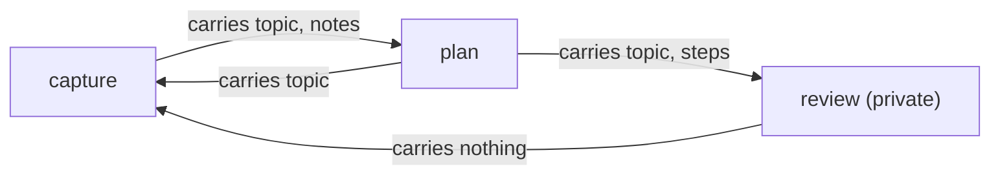
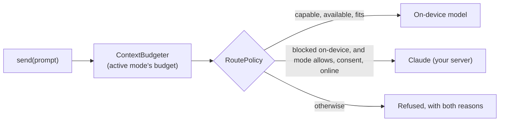

# AssistantModes

**One on-device assistant, several modes, and the rules that keep them apart.** A Swift package for building a multi-mode AI assistant on Apple's on-device model. Each mode activates its own group of instructions and its own token budget. Session state crosses a mode switch only where the graph says it may. A typed router keeps work on-device and sends it to Claude only when the device can't do it, and only if the mode, the user's consent and the network all allow it.

[](https://github.com/rajatslakhina/assistant-mode-engine-kit/actions/workflows/ci.yml)
  

Demo app: (added after the companion repo is pushed — see below)





## Why this matters

Apple's on-device model has a small context window and different capabilities on different hardware: as reported in a diff of the Xcode 27.3 beta SDK interface ([Foundation-Models-Framework-Lab PR #226](https://github.com/rudrankriyam/Foundation-Models-Framework-Lab/pull/226)), tvOS gets the system model without Private Cloud Compute, adapters or image input. The same SDK diff shows Apple moving towards *instruction groups* that switch on and off with app context. In a real app that raises questions a tutorial skips:

- When the user switches from "capture" to "plan", which instructions leave the context, and which facts come along?
- Who decides that a private mode never goes to the cloud, and where is that rule enforced, in a prompt or in code?
- What happens when the answer to a capture-mode prompt arrives *after* the user has already moved to plan mode?
- On Apple TV, what happens to a request that needs image input?

This package answers each of these in code, with a test that fails if the answer is broken.

## What's in it

| Type | Role |
|---|---|
| `ModeGraph`, `ModeDefinition` | The mode state machine. Construction throws on unknown targets, self-transitions, non-positive budgets, empty instructions, carried keys no mode can write (typos), modes unreachable from the initial one, and any transition that carries state out of a private mode into one that may escalate. If you hold a `ModeGraph`, those invariants hold. |
| `SessionState`, `StateKey`, `StateValue` | Typed state shared by the UI and the model. Each mode declares the only keys it may write. Each transition declares the only keys that survive it; everything else is cleared. Rendering is sorted, so the same state always produces the same prompt text. |
| `ContextBudgeter`, `TokenEstimator` | Fits instructions, state, history and the prompt into the active mode's budget. It also charges for the headers and `User:`/`Assistant:` prefixes the prompt adds, so the plan covers what is actually sent. Overflow never "fits". The engine also keeps a response reserve (1,024 tokens by default) free in the on-device window, because that window holds the answer too. |
| `PlatformProfile`, `Capability` | The per-platform capability matrix and context window. `iPhone(...)` and `appleTV(...)` presets. |
| `RoutePolicy`, `RouteDecision` | A pure decision table: `onDevice(plan)`, `escalate(because:)` or `refuse(because:blockedBy:)`. A request declares the capabilities it needs (for example `.imageInput`); carrying the image itself is the app's job. |
| `AssistantEngine` (actor) | Owns the active mode, state, transcript and records. Every way a turn can end is a `TurnOutcome`. |
| `EvalRunner`, `EvalCase` | Scripted transition and routing evals that run against any backend. The tests run them against a scripted model; the demo's `-scenario eval` runs them against Apple's model. |
| `StabilityProbe` | Sends one request N times and reports agreement, to measure how much the real model's output drifts. In the demo run against Apple's model: 90% agreement over 10 runs (2 distinct answers). |
| `SystemModelBackend` | `OnDeviceModel` backed by Foundation Models' `SystemLanguageModel` (compiled where the SDK has it, iOS/macOS 26+). |
| `AssistantModesUI` | `AssistantConsoleView`, an inspector that shows each turn's route and the reason for it. |

## Design decisions and trade-offs

**Per-mode transcripts, explicit carried state.** A mode switch clears the transcript and keeps only the keys that transition declares. *Rejected:* one shared transcript across modes. It is simpler, but the previous mode's instructions and answers bleed into the next mode's context, and the budget becomes impossible to reason about. The cost: a user who goes back to capture starts that conversation fresh, apart from whatever state was carried.

**Privacy rules live in the graph, not in a prompt.** `EscalationRule.forbidden` is enforced by `RoutePolicy` before any model is called: a request sent from a private mode never reaches the escalation model. `ModeGraph` closes the other path too: it refuses any transition that carries state out of a private mode into a mode that may escalate, so state written in a private mode can't leak through the next mode's escalation. A prompt that says "don't send this to the cloud" is a request to a model; these are branches the code can't take.

**One blocker, in a fixed priority order.** A missing capability is reported first, because no amount of waiting fixes it. Then model availability, which may fix itself. Then budget, which depends on this one prompt. Escalation gates are also ordered: the mode rule (a product decision), then consent (the user's), then connectivity (circumstance), then configuration (ours). The UI can always say exactly why.

**No silent failover.** If the on-device model throws, the turn is reported as `.failed`; it is not retried on Claude. An on-device refusal may be a guardrail, and retrying it elsewhere would route around it. *Rejected:* automatic cloud fallback, which hides both guardrail hits and on-device outages from the people who need to see them.

**History is trimmed as a contiguous suffix.** Oldest turns go first, and an old short turn is never kept after a newer long one was dropped. *Rejected:* greedy "fit whatever fits", which can produce a transcript with a hole in it, and that reads to the model as a different conversation.

**State goes in the prompt, never in the instructions.** Session state is user-supplied, so `SystemModelBackend` puts only the developer-written mode instructions in the session's instructions slot. User text is also indented on every continuation line, so a value can't start a line that looks like a `[key]` header or a `User:` label. That makes forged structure harder; it does not prevent prompt injection.

**A conservative token estimator.** By default the estimator divides UTF-8 bytes by 3 and rounds up. That over-counts English (about 4 characters per token) and lands near one token per character for CJK. Over-counting is the safe direction: being wrong costs one more dropped turn, not an overflowed context window. Swap in a real tokenizer through `TokenEstimator`.

## Concurrency contract

`AssistantEngine` is an actor, and actors give mutual exclusion *between* suspension points, not across them. `send` has exactly one `await` (the model call), and it is guarded explicitly:

- Everything the routing decision reads is captured before the `await`. `OnDeviceModel.availability` is synchronous on purpose, so the decision can't interleave with a mode switch.
- The model call runs in a child task the engine holds. `transition(to:)` may run while it is suspended: it cancels that call, frees the engine so the new mode can send at once, and bumps an epoch. An answer that still comes back is reported as `.discardedModeChanged` instead of being added to the new mode's transcript. Switching away and straight back still discards, because the context the answer was built from is gone.
- A second `send` during a generation is rejected with `.busy`, not queued or interleaved.
- Cancelling the caller's task cancels the model call and ends the turn as `.cancelled`. If the backend ignores cancellation and answers anyway, the answer is not kept.

## Honest limits

- **The 27.3 beta APIs are not used.** This package does not call `DynamicInstructionsGroup`, `@SessionState` or the other APIs seen in the Xcode 27.3 beta SDK diff. They are undocumented and were not in the toolchain used here (Xcode 27.2). The engine implements the same ideas in its own types, so it runs on shipping SDKs. Moving to Apple's types when they ship is an adapter change, not a redesign.
- **The platform presets are data, not verified facts.** `appleTV(...)` encodes what the SDK diff reports. It has not been checked on Apple TV hardware. Override the presets with what your target OS actually ships.
- **Token counts are estimates.** The budget is an upper bound only for estimators that round each piece up, like the default. It is not the model's tokenizer.
- **Capabilities are routing declarations, not payloads.** `send(_:needs: [.imageInput])` decides where a request may go; the package does not carry image data, and image tokens are not budgeted. Carrying the attachment to the chosen backend is the app's job.
- **Escalation sends the active mode's instructions, state and history to your cloud model.** That is the point of escalating, so a mode with sensitive state should be `forbidden`, and consent should be explicit. Revoking consent does not recall a request already sent, and changing state during a generation does not cancel it. The demo's Claude backend is simulated; a real one belongs behind your own server, never with an API key in the app.
- **Online and consent are caller-set flags.** There is no network monitoring, consent is one engine-wide boolean (not per mode or per request), and `TurnRecord` records the route and reason but not which data left the device.
- **Prompt injection is not prevented.** User text never goes in the instructions slot and is fenced by indentation, but a model can still be talked into things by its prompt.
- **The evals check routing and state, not answer quality.** `StabilityProbe` measures how much the output varies, not whether it is correct, and its numbers change from run to run.
- **`SystemModelBackend` is not covered by unit tests.** CI runners don't ship Foundation Models. It was exercised in the demo app on an iOS 27.2 Simulator on a Mac with Apple Intelligence (see the demo repo).
- **No tvOS or watchOS build.** The package declares and CI builds iOS and macOS only; Apple TV is a capability profile, and `SystemModelBackend` is not compiled for tvOS or watchOS.

## Install

```swift
.package(url: "https://github.com/rajatslakhina/assistant-mode-engine-kit.git", from: "1.0.0")
```

```swift
let graph = try ModeGraph(initialMode: "capture", modes: [
    ModeDefinition(id: "capture", title: "Capture", instructions: "Turn what the user says into notes.",
                   contextBudget: 1200, writableKeys: ["topic", "notes"],
                   transitions: ["plan": ["topic", "notes"]]),
    ModeDefinition(id: "plan", title: "Plan", instructions: "Turn the notes into steps.",
                   requirements: [.onDeviceText, .guidedGeneration], contextBudget: 2000,
                   writableKeys: ["steps"], transitions: ["capture": ["topic"]]),
])
let onDevice: any OnDeviceModel
if #available(iOS 26.0, macOS 26.0, *) {
    onDevice = SystemModelBackend()          // Apple's on-device model (needs an Xcode 26+ SDK)
} else {
    onDevice = ClosureModel(availability: .unavailable(.deviceNotEligible)) { _ in "" }
}
let engine = try AssistantEngine(
    graph: graph,
    profile: .iPhone(contextTokens: 4096),
    onDevice: onDevice,
    escalation: myClaudeClient,              // your server-backed EscalationModel, or nil
    cloudConsent: false
)
try await engine.setState(.text("Lisbon trip"), for: "topic")
switch await engine.send("passport expires in March") {
case .answered(let text, let route, _): print(route, text)
case .refused(let why, let blockedBy): print(why, blockedBy)
default: break
}
```

## Verification

(written after CI reports — see below)

## License

MIT
